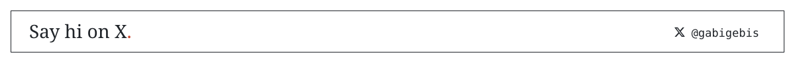

<picture>
  <source media="(prefers-color-scheme: dark)" srcset="./assets/console-dark-v4.svg" />
  <source media="(prefers-color-scheme: light)" srcset="./assets/console-v4.svg" />
  
</picture>

By day I build enterprise software with React, TypeScript, .NET and Azure. By night I'm usually making something that doesn't need to exist but deserves to: a tool, an experiment, a small piece of art that happens to be written in code.

I'm the kind of engineer who notices when a button is two pixels off and can't stop thinking about it. I think the best software feels like it was made by someone who cared, and that's the bar I hold myself to.

AI changes month to month, and I like keeping up. This GitHub is my playground for all of it: agent experiments, developer tools, and side projects where code oftentimes meets art.

<picture>
  <source media="(prefers-color-scheme: dark)" srcset="./assets/divider-dark-v4.svg" />
  <source media="(prefers-color-scheme: light)" srcset="./assets/divider-v4.svg" />
  
</picture>

<a href="https://x.com/gabigebis">
<picture>
  <source media="(prefers-color-scheme: dark)" srcset="./assets/footer-dark-v4.svg" />
  <source media="(prefers-color-scheme: light)" srcset="./assets/footer-v4.svg" />
  
</picture>
</a>
