<picture>
  <source media="(prefers-color-scheme: dark)" srcset="./assets/terminal-dark.svg" />
  <source media="(prefers-color-scheme: light)" srcset="./assets/terminal.svg" />
  
</picture>

I'm a full-stack software engineer who builds scalable enterprise applications and leads software initiatives from concept to delivery. I use AI every day to build smarter applications, move faster, and ship better products.

Professionally, I bring **5+ years of software engineering experience**, leading and building enterprise software end to end and creating solutions that solve real business problems and improve user experiences.

I graduated with a **B.S. in Computer Science**, *summa cum laude*.

**This GitHub is my playground.** It's where I explore personal interests, try new ideas, and build side projects, especially around AI and developer tools.

<a href="https://x.com/gabigebis">
<picture>
  <source media="(prefers-color-scheme: dark)" srcset="./assets/footer-dark.svg" />
  <source media="(prefers-color-scheme: light)" srcset="./assets/footer.svg" />
  
</picture>
</a>
