<picture>
  <source media="(prefers-color-scheme: dark)" srcset="./assets/header-dark.svg" />
  <source media="(prefers-color-scheme: light)" srcset="./assets/header.svg" />
  
</picture>

 

I'm a full-stack software engineer who builds scalable enterprise applications and leads software initiatives from concept to delivery. I use AI every day to build smarter applications, move faster, and ship better products.

**This GitHub is my playground.** It's where I explore personal interests, try new ideas, and build side projects, especially around AI and developer tools.

## Building now

<table>
  <tr>
    <td valign="top">
      <h4><a href="https://github.com/gabrielasu/REPO">project name</a> &nbsp;<code>in progress</code></h4>
      A customizable terminal companion that reacts to your Claude Code sessions. Designed with Claude Design, built and tested with Claude Code.
        
      <code>TypeScript</code> <code>CLI</code> <code>Claude Code</code>
    </td>
  </tr>
</table>

<!--
## Featured projects
Copy this block when you have more projects to show.

<table>
  <tr>
    <td width="50%" valign="top">
      <h4><a href="https://github.com/gabrielasu/REPO">project name</a></h4>
      One line on what it does and why it's interesting.
        
      <code>React</code> <code>AI</code>
    </td>
    <td width="50%" valign="top">
      <h4><a href="https://github.com/gabrielasu/REPO">project name</a></h4>
      One line on what it does and why it's interesting.
        
      <code>TypeScript</code>
    </td>
  </tr>
</table>
-->

## Toolkit

<picture>
  <source media="(prefers-color-scheme: dark)" srcset="https://skillicons.dev/icons?i=react,ts,dotnet,cs,azure,git&theme=dark" />
  <source media="(prefers-color-scheme: light)" srcset="https://skillicons.dev/icons?i=react,ts,dotnet,cs,azure,git&theme=light" />
  
</picture>

React · TypeScript · .NET · C# · SQL · Azure · AI-assisted development with Claude

## Most used languages

<picture>
  <source media="(prefers-color-scheme: dark)" srcset="https://github-readme-stats.vercel.app/api/top-langs/?username=gabrielasu&layout=compact&hide_border=true&border_radius=12&card_width=380&bg_color=1C1118&title_color=F6E6EC&text_color=CDB3BE" />
  <source media="(prefers-color-scheme: light)" srcset="https://github-readme-stats.vercel.app/api/top-langs/?username=gabrielasu&layout=compact&hide_border=true&border_radius=12&card_width=380&bg_color=FBF4F5&title_color=3B1F2B&text_color=6E5560" />
  
</picture>

## Background

B.S. in Computer Science, *summa cum laude*. Professionally, I lead and build enterprise software end to end, creating solutions that solve real business problems and improve user experiences.

## Connect

Always happy to connect with people working in software engineering and AI.

