<picture>
  <source media="(prefers-color-scheme: dark)" srcset="./assets/console-dark.svg" />
  <source media="(prefers-color-scheme: light)" srcset="./assets/console.svg" />
  
</picture>

I write software for a living and for fun. By day that means enterprise apps built end to end with React, TypeScript, .NET and Azure. AI sits in the middle of all of it: I use it to explore ideas, write first drafts, test and review, and I keep the judgment calls for myself.

Off the clock I'm curious about multi-agent systems, where a small team of specialized agents plans, builds and reviews each other's work, and about AI tools that make a developer's day a little more personal.

This GitHub is my playground for all of it: agent experiments, developer tools, and side projects where code oftentimes meets art.

<picture>
  <source media="(prefers-color-scheme: dark)" srcset="./assets/divider-dark-v2.svg" />
  <source media="(prefers-color-scheme: light)" srcset="./assets/divider-v2.svg" />
  
</picture>

<a href="https://x.com/gabigebis">
<picture>
  <source media="(prefers-color-scheme: dark)" srcset="./assets/footer-dark-v2.svg" />
  <source media="(prefers-color-scheme: light)" srcset="./assets/footer-v2.svg" />
  
</picture>
</a>
